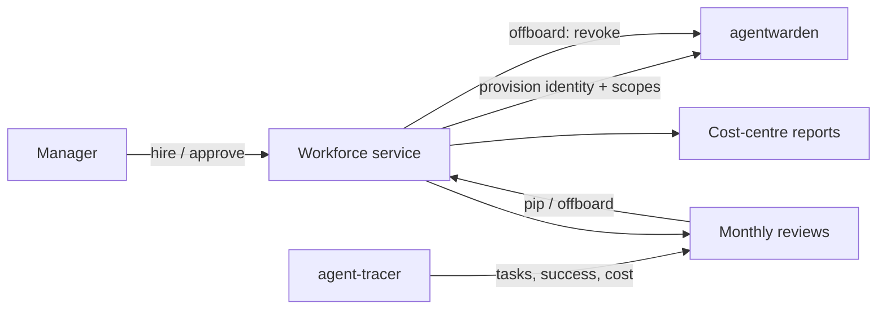

# Architecture — agent-workforce

## 1. Scope
System of record for AI agents as digital workers: lifecycle, onboarding, reviews, offboarding, spend.
**MVP:** worker records with a lifecycle (`onboarding → probation → active ↔ pip → offboarded`),
onboarding checklist templates (default, finance), metric-based reviews → rating and action,
offboarding plan, cost-centre reporting.
**Product:** agentwarden credential sync, agent-tracer metric ingestion, approvals, org chart UI.

## 2. System context

## 3. Review model
`score = 100·success_rate − 40·escalation_rate − 15·max(0, cost_per_task/target − 1) − 25·incidents`.
Two or more incidents, or a success rate under 60%, is *unacceptable* and leads to offboarding.
Score ≥ 92 *exceeds* and expands scope. Score ≥ 82 *meets* and keeps the agent. Anything else is
*below*, which puts the agent on a PIP. The status follows automatically.

## 4. Design decisions
- **The onboarding gate is enforced.** An agent can't be activated with an incomplete checklist,
  which is the control auditors ask for.
- **Offboarding produces a plan** (credentials to revoke, artefacts to transfer, logs to archive,
  lifetime cost) instead of silently deleting. Humans approve and the integration executes.
- **Reviews are pure functions of metrics.** They're reproducible, and their thresholds are
  versioned policy.

## 5. Production architecture
Postgres (workers, checklists, reviews, spend by month), an event-driven integration with
agentwarden (revoke on offboard, scope changes on promotion), monthly review jobs pulling from
agent-tracer, and SOC 2-friendly audit exports.

## 6. Risks
Metric definitions vary by role (an SDR is not an AP clerk), so role-specific scorecards with
the same pipeline are needed.
